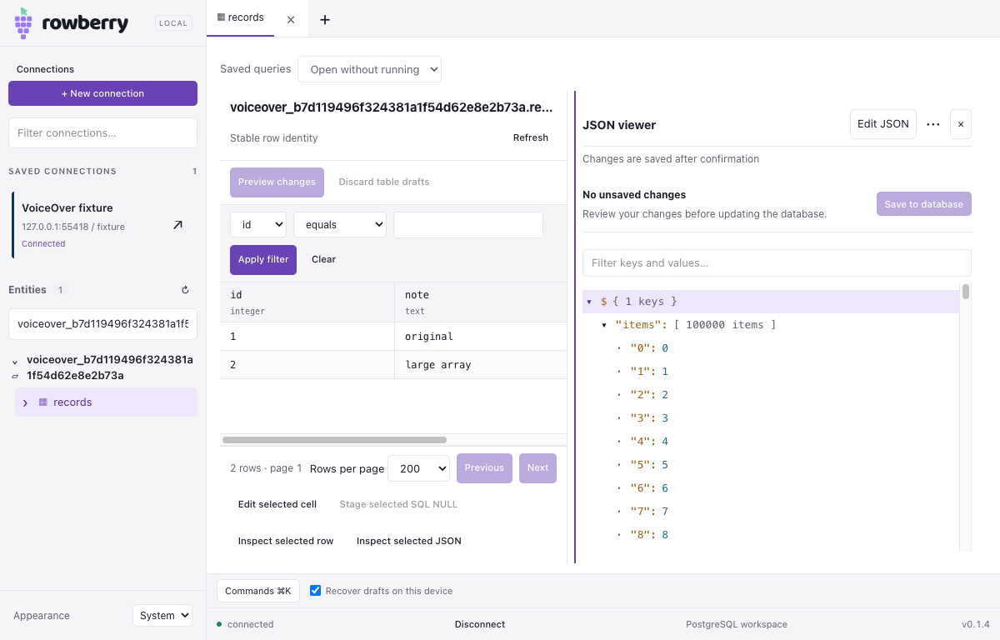

# Signed 0.1.4 VoiceOver qualification — 16 November 2026

**Result: partial evidence; native Home remains failed and unqualified.** The opt-in large-array harness correctly exits with failure. No application fix or full accessibility pass is claimed.

## Candidate and environment

- Signed Rowberry 0.1.4, Apple silicon, app source `eecd6736d369476b01a765af32afa576ae48d982`.
- `app.asar` SHA-256: `3fe78a8edbb9b45163635b74797de1b3367d3faab36195486a40e416a296661e`.
- Apple M4, 32 GiB RAM, macOS 27.3 (`26C5035r`), English VoiceOver.
- Disposable PostgreSQL 18 schema and isolated application profile; no personal connections or Keychain credentials.

```sh
DBAPP_VOICEOVER=1 \
DBAPP_PACKAGE_EXECUTABLE="$PWD/release-signed/0.1.4/mac-arm64/Rowberry.app/Contents/MacOS/Rowberry" \
bun run verify:voiceover --large-array
```

## Observed speech and focus

The initial signed run passed nine fresh-speech checks: small-array selection, expansion, collapse and scalar naming; large-array selection and expansion; first and last array positions; and navigation after scrolling the active descendant out of view. The numeric scenarios also verified the selected value, ARIA ordinal/count, tree focus at the assertion and fewer than 40 mounted rows.

Actual phrases included `0: 0 ... (1 of 100,000)`, `99999: 99999 ... (100,000 of 100,000)` and `99998: 99998 ... (99,999 of 100,000)`. Matchers normalize numeric grouping without accepting a different ordinal or count.

Native Home then selected the root but failed to read it. A focused diagnostic recorded Home reaching the JSON tree, followed by DOM focus moving to **Resize JSON panel**. Passing Home through with VO-Tab did not resolve it, including a diagnostic that waited for VoiceOver's `Ignoring next keypress` acknowledgement. The run stopped before the preview/cancellation scenarios; those are not counted as qualified on this candidate by this run.



[Retained reports](2026-11-16-native-voiceover-diagnostics.json) include the original failure, the passed-through failure and the relevant controls:

- Native Home also failed in the small tree, so virtualization is not required to reproduce it.
- Native Up to the same small-tree root produced fresh root speech and retained tree focus.
- Browser-dispatched Home produced fresh root speech in the small tree. This is diagnostic evidence, not native-keyboard qualification.
- Native Home with VoiceOver off retained focus in the small tree. No speech was tested in that control.
- The operator reported that physical Fn–Left did nothing. The manual diagnostic received no Home event and was closed deliberately; this attempt is inconclusive.

Experimental changes to virtual-row order, ancestor retention, previous-row retention and hidden-editor synchronization did not resolve native Home and were removed. Application source and version remain unchanged. The exact cause across native input, VoiceOver and Electron is still undetermined; no screen-reader setting or upstream defect is asserted as the cause.

## Follow-up

Keep native Home open in the v1 evidence register. Reproduce it with a confirmed physical Home event, inspect native event modifiers/routing and compare with the browser-dispatched control before changing application focus behavior. Preserve this failure when a later candidate passes. Repeat the full native run, including preview cancellation, after a demonstrated fix.

### Input-path controls with VoiceOver off

Six further controls passed on the same signed 0.1.4 package: native System Events Home and browser-dispatched Home in each of three application accessibility configurations. [The complete key/focus traces](2026-11-16-keyboard-mode-controls.json) are retained; no speech was captured or qualified.

The disposable profile/schema and small JSON fixture were the same as the native harness. For each case, the diagnostic requested the feature set below, clicked `name: Rowberry`, confirmed tree focus, cleared the event buffers, sent Home and inspected selection/focus after 200 ms. It observed Electron's `before-input-event`, window focus/blur and DOM key/focus events without changing event handling. The temporary diagnostic script was removed after the experiment; these controls describe the procedure and preserve its actual output.

| Requested application configuration   | Features observed before input                                       | Native Home | Browser Home |
| ------------------------------------- | -------------------------------------------------------------------- | ----------- | ------------ |
| Empty feature set                     | `nativeAPIs`, `webContents`                                          | Passed      | Passed       |
| Accessibility support                 | `nativeAPIs`, `webContents`, `inlineTextBoxes`, `extendedProperties` | Passed      | Passed       |
| Accessibility plus screen-reader mode | Same four features plus `screenReader`                               | Passed      | Passed       |

The first configuration was **not accessibility-disabled** in practice. Application accessibility configuration is distinct from running the macOS VoiceOver service; the service stayed off for these controls.

Native Home reached Electron's input hook as `key: Home`, `code: Home`, location 0, no reported modifiers. Browser-dispatched Home produced no `before-input-event` record. Both paths delivered Home to the JSON tree, whose DOM handler set `defaultPrevented: true`; the root was selected and focus remained on the tree. Therefore matching DOM events do not establish equivalent native input paths.

These results show that the tested Chromium accessibility modes alone are insufficient to reproduce the failure. They do not rule out interactions that require the running VoiceOver service, and reported modifier fields do not establish the complete native macOS event flags. The linked Electron [Windows alert/confirm issue](https://github.com/electron/electron/issues/41602) and [older Windows dialog-focus issue](https://github.com/electron/electron/issues/20821) have different reproduction conditions; no blur/refocus workaround was added.

The harness now records bounded navigation/focus traces and verifies UI state after matching speech and input complete. During the next live run, compare focus movement with the [Electron input hook](https://www.electronjs.org/docs/latest/api/web-contents#event-before-input-event), not just DOM keydown, and use native Up-to-root as the passing control. The stronger harness has not yet repeated native speech qualification.

This record does not qualify all VoiceOver settings, minimum-supported macOS, other screen readers or broader unfamiliar-user task completion. The separate [signed performance refresh](json-performance-and-accessibility.md#signed-014-refresh-16-november-2026) passed all six bounded scenarios; that result is not screen-reader evidence.
